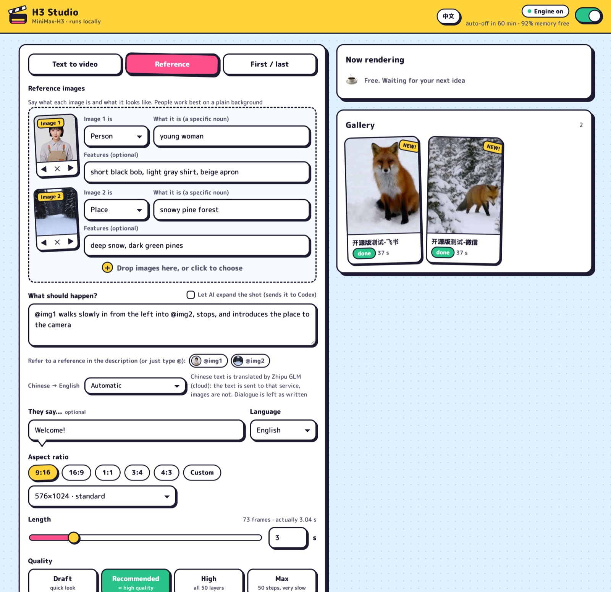

# H3 Studio

**English** | [简体中文](README.zh-CN.md)

A small web UI and job queue for [h3.c](https://github.com/antirez/h3.c), antirez's C + Metal implementation of the MiniMax-H3 video-and-audio model. It lets you make clips on your own Mac from a browser (or your phone) instead of a terminal.



- **Three modes**: text to video, reference (images, video, audio), first / last frame.
- **No LLM needed for prompts.** You write one sentence and one line of dialogue; the server wraps them in the structured format H3 was trained on. An LLM rewriter is available as a plugin.
- **`@` mentions** for references (`@img1 walks into @img2`), converted to the model's own labels, including the shared audio numbering that is easy to get wrong by hand.
- **A queue with an on/off switch.** The server stays resident and light and never loads the model. Each job is its own `h3` process, so memory is freed when it ends. The switch turns itself off after an idle hour.
- **Time estimates, progress, a gallery**, and "again with a new seed".
- **English and Chinese UI**, one button to switch.
- **Plugins**: on-device translation of Chinese prompts (macOS), Zhipu GLM translation, Codex prompt rewriting, and delivery to chat through Hermes Agent. All optional.
- Python standard library only. No build step, no npm, no pip.

## Requirements

- An Apple Silicon Mac that can run h3.c. Generation peaks at roughly 18–26 GB of memory.
- [h3.c](https://github.com/antirez/h3.c) built (`make`), and the MiniMax-H3 weights: `FL2VA/`, plus `Ref2VA/` for reference mode.
- Python 3.9 or later (the one shipped with macOS works) and `ffmpeg` on the PATH (`brew install ffmpeg`).

## Quick start

```bash
git clone https://github.com/shisaq/h3-studio.git
cd h3-studio
mkdir -p ~/.config/h3d && cp config.example.json ~/.config/h3d/config.json
# edit ~/.config/h3d/config.json: set h3_dir and model_dir
python3 h3d.py
```

Open <http://127.0.0.1:8190>, write a sentence, press **Action!**.

To keep it running in the background (starts at login): `scripts/install-launchagent.sh`.

## Configuration

`~/.config/h3d/config.json` (or the file named by `$H3D_CONFIG`). Restart the server after editing.

| Key | Default | Meaning |
| --- | --- | --- |
| `h3_dir` | `~/h3.c` | The h3.c checkout containing the built `h3` binary |
| `model_dir` | `~/h3.c/MiniMax-H3` | Folder containing `FL2VA/` and optionally `Ref2VA/` |
| `output_dir` | `~/h3-studio/jobs` | One folder per job: video, poster, prompt, log, inputs |
| `state_dir` | `~/.local/state/h3d` | Job list and upload cache (uploads expire after 7 days) |
| `host`, `port` | `127.0.0.1`, `8190` | Where to listen |
| `allow` | loopback only | Networks allowed to connect, as CIDR blocks |
| `lang` | `en` | Language of notifications and `h3ctl` output (`en` or `zh`). The web UI has its own switch |
| `idle_minutes` | `60` | The engine switches itself off after this long without work |
| `speed_factor` | `1.0` | Multiplies the time estimates, which were fitted on an M5 Pro |
| `plugins` | `["macos_translate"]` | Plugins to load, in order |
| `plugin_config` | `{}` | Settings per plugin, keyed by plugin name |
| `public_url` | | Printed by `h3ctl status`, e.g. your Tailscale address |

### Using it from your phone

**There is no login.** Anyone who can reach the port can submit jobs, see your gallery and delete from it. Do not expose it to the internet. To use it from other devices, listen on all interfaces and allow only a private network, for example Tailscale:

```json
"host": "0.0.0.0",
"allow": ["127.0.0.0/8", "::1/128", "100.64.0.0/10", "fd7a:115c:a1e0::/48"]
```

## Writing prompts

H3 wants a structured prompt. Free text gives vague motion and, above all, **mumbled speech**. What makes speech intelligible is the dialogue tag `<d>[English] Hello</d>`, and the built-in composer adds it for you. In a same-seed comparison it matched an LLM-written prompt.

Things that tested well, mostly for reference mode:

- With two or more reference images, say what each one **is**, using a specific noun ("young woman", "snowy pine forest"). With a generic "person" or "place" the model mostly follows one image and ignores the other.
- People work best on a plain background. A scene image should not contain an eye-catching person or animal.
- When there is a scene image, the composer adds "only the subject is taken from the other images". Without it, the person image's own background took over the frame in about half the runs.
- Describe the action concretely: where they enter from, what they do, where they stop, where they face.
- Write in English. Chinese is translated if a translator plugin is available; dialogue is never translated.
- Background music is off by default (the model's own score tends to be loud). Turn it on under Advanced.
- Limits: 9 images, 12 references in total, 3 references that carry sound, 15 seconds, 768×1344 pixels.

Longer clips cost more per second. On an M5 Pro at 576×1024, recommended quality: 2 s takes about 3 minutes, 5 s about 7.5 minutes, 9 s about 17 minutes.

## Plugins

A plugin is one file in `plugins/` with a `register(api)` function. Enable it by adding its file name (without `.py`) to `plugins` in the config.

| Plugin | What it adds | Needs |
| --- | --- | --- |
| `macos_translate` | Chinese → English on this device. Text never leaves the machine | macOS 15+, `scripts/build-translate.sh`, and the Chinese and English packs from System Settings → General → Language & Region → Translation Languages |
| `zhipu_translate` | Chinese → English with Zhipu GLM (cloud, free tier) | An API key in `~/.config/h3d/zhipu.key` or `$ZHIPU_API_KEY` |
| `codex_rewrite` | "Let AI expand the shot": an LLM writes the full prompt from your sentence and reference images | The Codex CLI, logged in, and MiniMax's two prompt guides copied into `guides/` (they may not be redistributed, so they are not in this repository) |
| `hermes_notify` | Sends the finished video to a chat through [Hermes Agent](https://github.com/NousResearch/hermes-agent). `plugins/hermes/skill` lets Hermes run h3 from chat | Hermes Agent with a messaging platform set up |

Translators are tried in the order they are listed; if one fails, the next is used. In the UI you can also pick "on this device only" or "don't translate" per job.

Plugin settings go under `plugin_config`, keyed by plugin name. For example, `codex_rewrite` uses whatever model Codex is configured to use (`model` in `~/.codex/config.toml`), so it follows when you switch Codex to a newer model. To pin a model for h3 only:

```json
"plugins": ["macos_translate", "codex_rewrite"],
"plugin_config": {
  "codex_rewrite": {
    "model": "",
    "proxy": ""
  }
}
```

Leave `model` empty to follow Codex, or set a model name. If the named model fails, the plugin retries with the Codex default. Other keys: `codex_bin` (default: `codex` on PATH), `timeout` (seconds, default 240), `guide_dir` (default: `guides/`), `proxy` (e.g. `http://127.0.0.1:7890` if Codex needs one). The settings for each plugin are listed at the top of its file.

### Writing your own

```python
# plugins/my_plugin.py
def register(api):
    cfg = api.config                      # plugin_config["my_plugin"] from the config file

    def translate(texts):                 # list of Chinese strings -> list of English strings
        return [my_engine(t) for t in texts]
    api.register_translator(translate, available=lambda: True, local=False, label=api.L("我的引擎", "My engine"))

    def rewrite(req):                     # description + references -> a full structured prompt
        return call_my_llm(req["description"], [api.upload_path(i) for i in req.get("images", [])])
    api.register_rewriter(rewrite, label=api.L("我的模型", "My LLM"))

    def send(target, text, video=None, cover=None):
        post_somewhere(target, text, video)
    api.register_notifier(send, targets=lambda: [{"target": "me", "label": "My phone"}])
```

Register only what you need. Keep `[[P1]]`-style tokens intact when translating: they stand for `@` mentions. `plugins/` has four working examples.

## Command line

`h3ctl` talks to the running server, so scripts and chat agents share the same queue:

```bash
./h3ctl submit --desc "A red fox walks through a snowy pine forest" --dialogue "Hello" --seconds 3
./h3ctl submit --image woman.jpg --about "person: young woman | short black bob" \
               --image forest.jpg --about "scene: snowy pine forest" \
               --desc "@img1 walks slowly into @img2 and stops" --size 16:9 --seconds 5
./h3ctl status | jobs | job ID | cancel ID | start | stop
```

## Tests

```bash
python3 -m unittest discover tests
```

## Credits and license

MIT for the code in this repository. h3.c is by Salvatore Sanfilippo (antirez). The MiniMax-H3 model and its prompt guides belong to MiniMax and are under their own license; nothing of theirs is included here. This project is not affiliated with either.
