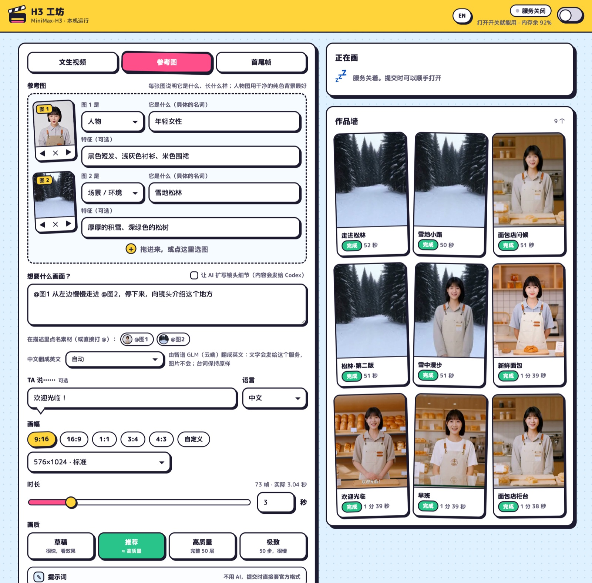

# H3 工坊（H3 Studio）

[English](README.md) | **简体中文**

给 [h3.c](https://github.com/antirez/h3.c) 做的网页界面和任务队列。h3.c 是 antirez 用 C + Metal 写的 MiniMax-H3 音视频生成模型实现。有了它，就能在浏览器（或手机）里用自己的 Mac 生成短视频，不用开终端。



- **三种模式**：文生视频、参考生成（图片、视频、音频）、首尾帧。
- **写提示词不需要大模型。**写一句画面、一句台词，后台直接套进 H3 训练时用的结构化格式。想让大模型扩写，可以装插件。
- **用 `@` 点名素材**（`@图1 走进 @图2`），后台换算成模型自己的编号，包括手算容易出错的音频混排编号。
- **带开关的队列。**服务常驻但很轻，自己不加载模型；每个任务是独立的 `h3` 进程，跑完就释放内存。开关空闲一小时自动关。
- **预计用时、进度、作品墙**，以及「换个种子再来」。
- **中英文界面**，一个按钮切换。
- **插件**：本机翻译（macOS）、智谱翻译、Codex 扩写提示词、通过 Hermes Agent 推送到聊天软件。都可以不装。
- 只用 Python 标准库，不需要构建，不需要 npm 和 pip。

## 需要什么

- 一台跑得动 h3.c 的 Apple 芯片 Mac。生成时内存峰值大约 18–26 GB。
- 编译好的 [h3.c](https://github.com/antirez/h3.c)（`make`）和 MiniMax-H3 模型：`FL2VA/`；用参考模式还要 `Ref2VA/`。
- Python 3.9 以上（macOS 自带的就行），以及 PATH 里有 `ffmpeg`（`brew install ffmpeg`）。

## 快速开始

```bash
git clone https://github.com/shisaq/h3-studio.git
cd h3-studio
mkdir -p ~/.config/h3d && cp config.example.json ~/.config/h3d/config.json
# 编辑 ~/.config/h3d/config.json：填好 h3_dir 和 model_dir，中文用户把 lang 改成 zh
python3 h3d.py
```

打开 <http://127.0.0.1:8190>，写一句话，点**开拍！**。

要让它在后台常驻（登录后自动启动）：`scripts/install-launchagent.sh`。

## 配置

`~/.config/h3d/config.json`（或环境变量 `$H3D_CONFIG` 指定的文件）。改完要重启服务。

| 配置项 | 默认值 | 含义 |
| --- | --- | --- |
| `h3_dir` | `~/h3.c` | h3.c 的目录，里面有编译好的 `h3` |
| `model_dir` | `~/h3.c/MiniMax-H3` | 模型目录，里面有 `FL2VA/`，可选 `Ref2VA/` |
| `output_dir` | `~/h3-studio/jobs` | 每个任务一个文件夹：视频、封面、提示词、日志、输入素材 |
| `state_dir` | `~/.local/state/h3d` | 任务列表和上传缓存（上传的文件 7 天后清理） |
| `host`、`port` | `127.0.0.1`、`8190` | 监听地址 |
| `allow` | 仅本机 | 允许访问的网段（CIDR） |
| `lang` | `en` | 推送消息和 `h3ctl` 输出的语言（`en` 或 `zh`）。网页有自己的切换按钮 |
| `idle_minutes` | `60` | 空闲这么久后自动关闭 |
| `speed_factor` | `1.0` | 预计用时的倍数。估算是按 M5 Pro 拟合的 |
| `plugins` | `["macos_translate"]` | 要加载的插件，按顺序 |
| `plugin_config` | `{}` | 各插件的设置，以插件名为键 |
| `public_url` | | `h3ctl status` 里显示的网址，比如 Tailscale 地址 |

### 在手机上用

**没有登录。**能连上端口的人都可以提交任务、看作品、删作品。不要暴露到公网。要在其他设备上用，监听所有网卡，并且只放行私有网络，例如 Tailscale：

```json
"host": "0.0.0.0",
"allow": ["127.0.0.0/8", "::1/128", "100.64.0.0/10", "fd7a:115c:a1e0::/48"]
```

## 提示词怎么写

H3 要结构化提示词。随便写一段话，动作会走样，更明显的是**台词含糊不清**。让台词说清楚的是 `<d>[Chinese] 欢迎光临！</d>` 这个标签，内置的组装会自动加上。同一个种子对比，效果和大模型写的提示词相当。

实测有效的做法，主要针对参考模式：

- 两张以上参考图时，每张图都要写明它**是什么**，用具体的名词（young woman、snowy pine forest）。写成笼统的 person、place，模型多半只照着其中一张画。
- 人物图用干净的纯色背景最好。场景图里不要有抢眼的人或动物。
- 有场景图时，组装会自动加一句「其余图只取主体」。不加这句，人物图自带的背景大约一半概率抢占画面。
- 动作要写具体：从哪边进来、做什么、停在哪、朝向哪。
- 用英文写最稳。装了翻译插件时中文会自动翻成英文；台词不翻译。
- 默认不加背景音乐（模型自己配的往往偏吵）。要加在「高级参数」里勾选。
- 上限：图片 9 张、素材合计 12 个、带声音的素材 3 个、时长 15 秒、分辨率 768×1344 的面积。

时长越长，每秒越贵。M5 Pro、576×1024、推荐画质：2 秒约 3 分钟，5 秒约 7.5 分钟，9 秒约 17 分钟。

## 插件

一个插件就是 `plugins/` 里的一个文件，里面有 `register(api)` 函数。把文件名（不带 `.py`）加进配置的 `plugins` 就启用了。

| 插件 | 作用 | 需要 |
| --- | --- | --- |
| `macos_translate` | 本机把中文翻成英文，文字不出这台机器 | macOS 15 以上；运行 `scripts/build-translate.sh`；在 系统设置 → 通用 → 语言与地区 → 翻译语言 下载中文和英语 |
| `zhipu_translate` | 用智谱 GLM 翻译（云端，有免费额度） | 密钥放在 `~/.config/h3d/zhipu.key` 或环境变量 `$ZHIPU_API_KEY` |
| `codex_rewrite` | 「让 AI 扩写镜头细节」：大模型根据你的一句话和参考图写出完整提示词 | 已登录的 Codex 命令行；把 MiniMax 的两份官方提示词指南拷进 `guides/`（它们不允许再分发，所以不在本仓库里） |
| `hermes_notify` | 做好后通过 [Hermes Agent](https://github.com/NousResearch/hermes-agent) 发到聊天软件。`plugins/hermes/skill` 让 Hermes 能在对话里调用 h3 | 配好消息平台的 Hermes Agent |

翻译引擎按列出的顺序尝试，前一个失败就用下一个。网页里每次提交还可以选「只用本机翻译」或「不翻译」。

插件的设置写在 `plugin_config` 里，以插件名为键。例如 `codex_rewrite` 默认用 Codex 自己设置的模型（`~/.codex/config.toml` 里的 `model`），在 Codex 里换了新模型，它就跟着换。想只给 h3 固定一个模型：

```json
"plugins": ["macos_translate", "codex_rewrite"],
"plugin_config": {
  "codex_rewrite": {
    "model": "",
    "proxy": ""
  }
}
```

`model` 留空就跟随 Codex，填模型名就固定用它；指定的模型调用失败时，会退回 Codex 的默认模型再试一次。其他可选项：`codex_bin`（默认在 PATH 里找 `codex`）、`timeout`（秒，默认 240）、`guide_dir`（默认 `guides/`）、`proxy`（Codex 需要走代理时填，如 `http://127.0.0.1:7890`）。每个插件能设什么，写在插件文件开头的说明里。

### 自己写一个

```python
# plugins/my_plugin.py
def register(api):
    cfg = api.config                      # 配置文件里的 plugin_config["my_plugin"]

    def translate(texts):                 # 中文字符串列表 -> 英文字符串列表
        return [my_engine(t) for t in texts]
    api.register_translator(translate, available=lambda: True, local=False, label=api.L("我的引擎", "My engine"))

    def rewrite(req):                     # 描述 + 参考素材 -> 完整的结构化提示词
        return call_my_llm(req["description"], [api.upload_path(i) for i in req.get("images", [])])
    api.register_rewriter(rewrite, label=api.L("我的模型", "My LLM"))

    def send(target, text, video=None, cover=None):
        post_somewhere(target, text, video)
    api.register_notifier(send, targets=lambda: [{"target": "me", "label": "我的手机"}])
```

用到哪个注册哪个。翻译时要原样保留 `[[P1]]` 这类标记，它们代表 `@` 点名的素材。`plugins/` 里有四个可以直接参考的例子。

## 命令行

`h3ctl` 和运行中的服务通信，脚本、聊天机器人和网页共用同一个队列：

```bash
./h3ctl submit --desc "一只红狐在松林雪地里行走" --dialogue "你好" --language Chinese --seconds 3
./h3ctl submit --image woman.jpg --about "person: young woman | short black bob" \
               --image forest.jpg --about "scene: snowy pine forest" \
               --desc "@图1 慢慢走进 @图2，停下来" --size 16:9 --seconds 5
./h3ctl status | jobs | job ID | cancel ID | start | stop
```

## 测试

```bash
python3 -m unittest discover tests
```

## 致谢与许可

本仓库的代码采用 MIT 许可。h3.c 的作者是 Salvatore Sanfilippo（antirez）。MiniMax-H3 模型及其提示词指南属于 MiniMax，适用它们自己的许可；本仓库不包含其中任何内容。本项目与两者均无隶属关系。
